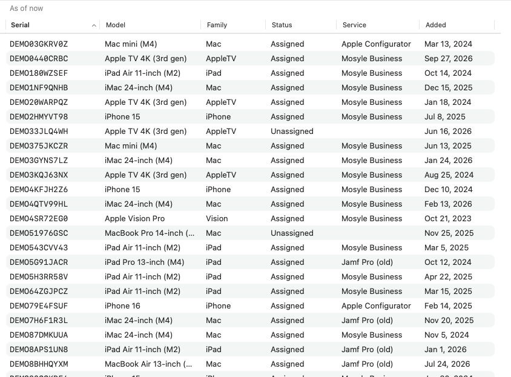
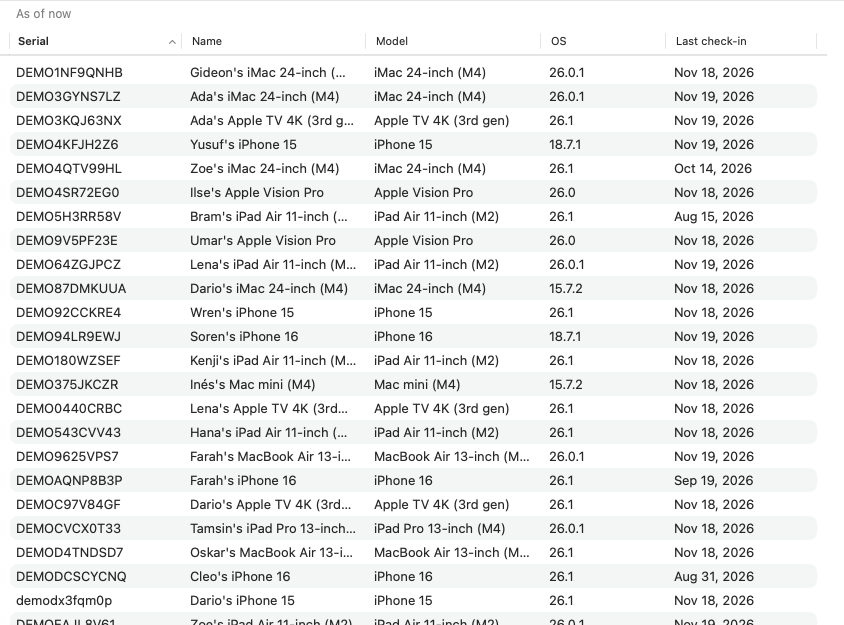
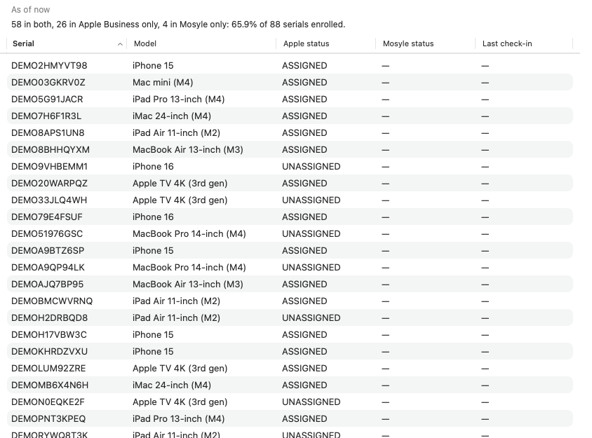
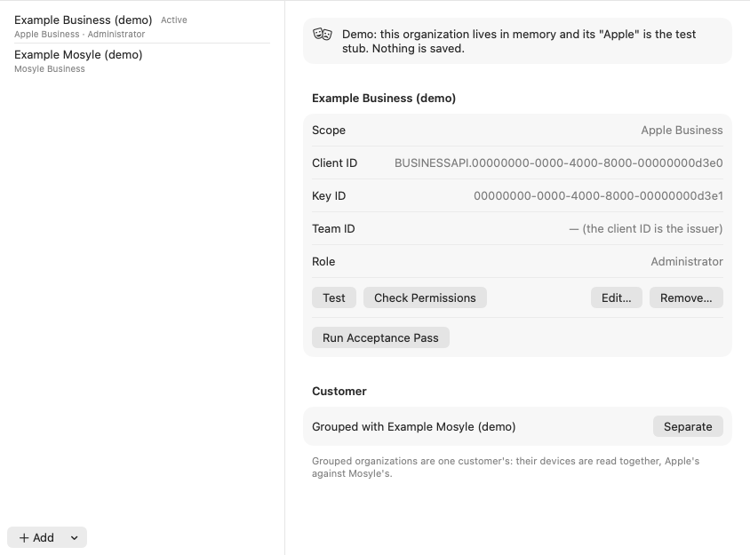

# swiftabapit

[](https://github.com/goetchstone/swiftabapit/actions/workflows/ci.yml)
[](https://github.com/goetchstone/swiftabapit/actions/workflows/codeql.yml)
[](https://scorecard.dev/viewer/?uri=github.com/goetchstone/swiftabapit)
[](LICENSE)

**abapit** as a native macOS app: a sandboxed SwiftUI front end for the
[Apple Business API](https://developer.apple.com/documentation/applebusinessapi) (2.8), the
[Apple School Manager API](https://developer.apple.com/documentation/appleschoolmanagerapi) (1.8) and
Mosyle Business, for Mac admins. It replaces abapit, an earlier Python web tool, and its tests hold it
to abapit's behaviour where abapit was right.

**Status: in progress; reads only, and no write exists.** The app reads Apple Business, Apple School Manager and
Mosyle Business: devices, people, content, Apple MDM, activity, Mosyle's lists and the Apple-against-Mosyle
reconciliation with Device 360, with CSV export, clients and a built-in demo organization. All of it is tested against
strict stubs, Apple's published API contracts and parity goldens from abapit. The operator checked parts of it on live
organizations on 2026-11-19: the build signs and provisions with the App Sandbox on, the Keychain and vault spikes
passed, the first pass over Apple Business's reads ran (its answers are in
[docs/domains/apple-reads.md](docs/domains/apple-reads.md)) and Mosyle's login worked. Mosyle's device list waits for an
open pull request, and Apple School Manager is not verified on a live tenant. The write path, history and snapshots,
Needs attention and Apple's on-device model are planned, not built; the write path waits for the operator's answers to
its design. The plan and its Status lines are in
[docs/plans/2026-10-16-swift-port.md](docs/plans/2026-10-16-swift-port.md).

Not affiliated with Apple or Mosyle.

## Screens

Drawn by CI from the built-in demo organization, which holds no real data; the full set is in
[docs/screenshots](docs/screenshots).










## How it's built to be safe

- **No server.** The app opens no port; it makes outbound HTTPS calls to five hosts only (Apple's token
  endpoint, the Business and School APIs, Mosyle's API and Logs Stream), and refuses a redirect anywhere
  else. App Sandbox and the hardened runtime are on; `scripts/check_app.sh` checks the exact entitlements.
- **Keys in the Keychain.** An Apple API key is imported once into the data-protection Keychain, this Mac
  only, behind Touch ID; tokens and signed assertions live only in memory. Mosyle credentials too.
- **One write path (planned; no write is built yet).** Every change will be planned, shown as the exact request it
  will send, confirmed by you, checked again, and then that held request is sent and audited. Nothing else in the app
  will be able to send a write.
- **On-device AI will only draft (planned; not built yet)**, except a short, off-by-default list of single-device
  actions you can switch on per organization (play a sound, request a location, assign one device).
- **Zero third-party dependencies.**

## Building

macOS 27 and Xcode 27. There are no downloadable builds yet: you build it yourself.

```bash
scripts/test.sh
xcodebuild -project SwiftAbapit.xcodeproj -scheme abapit -derivedDataPath build/DerivedData.noindex build
```

An ad-hoc build can't use the data-protection Keychain. To store keys, sign with your team (a free
Personal Team works, verified 2026-11-19 with the App Sandbox on): create `Config/Local.xcconfig` with
`DEVELOPMENT_TEAM`, `CODE_SIGN_IDENTITY = Apple Development` and `CODE_SIGN_ENTITLEMENTS = Config/abapit-Team.entitlements`, then build once in
Xcode so it provisions the keychain access group. A Personal Team build expires after 7 days, so rebuild it weekly.

## Clients and schools

One app can read several customers' organizations, one customer (a **client**) at a time: an Apple Business or Apple
School Manager organization and, optionally, its Mosyle Business organization. With one client the app shows no client
at all; with two or more, a switcher. Nothing on screen or in an export mixes two clients. Adding an organization asks
which customer it's for whenever another one could be grouped with it, and Settings can separate the two again.

Apple School Manager support is built from Apple's published documentation and **isn't verified on a live tenant yet**:
no school has tested it.

## Live verification

Every write is unproven until it has run against a real organization on a scratch object
([live-verify](.claude/skills/live-verify/SKILL.md)). None is built yet.

| Write | Status |
|---|---|
| — | — |

## Working on it

Start with [CLAUDE.md](CLAUDE.md): the invariants, the rules of engagement and the self-improvement loop
(skills in `.claude/skills/`, the [failure log](docs/failure-log/README.md), the
[rule feedback ledger](docs/RULE-FEEDBACK.md), [runbooks](docs/domains/README.md)).
